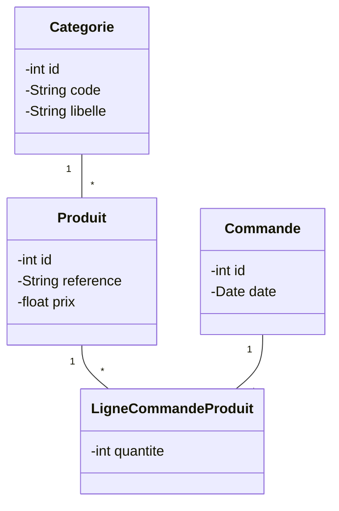
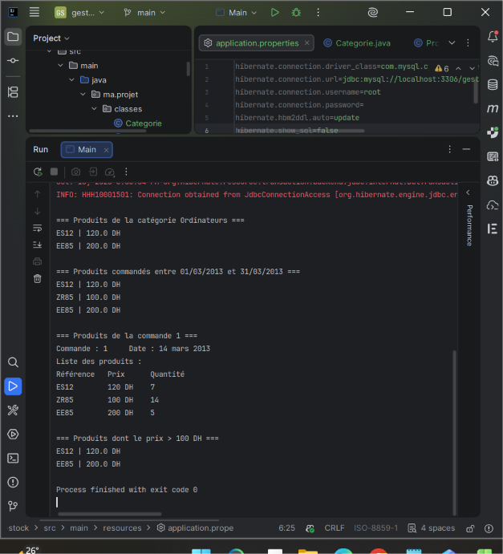
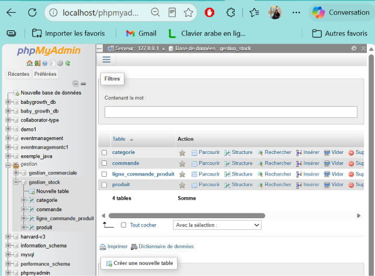
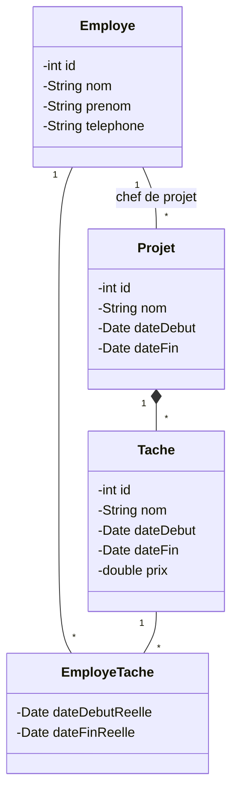
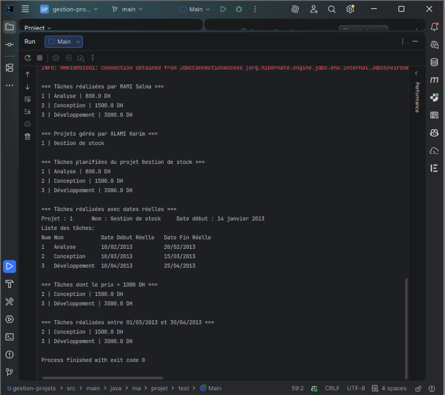
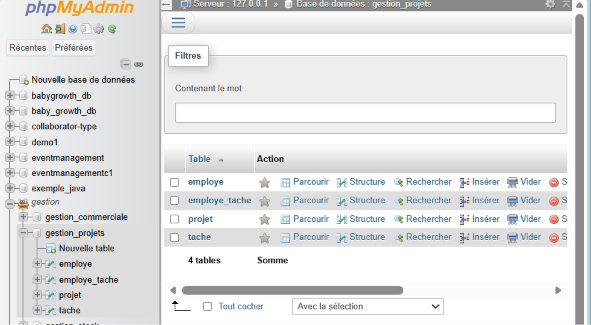
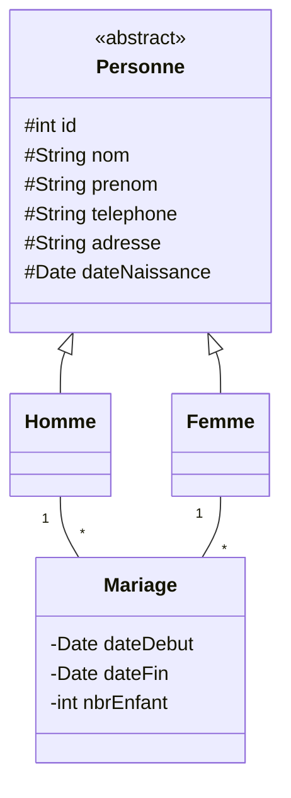
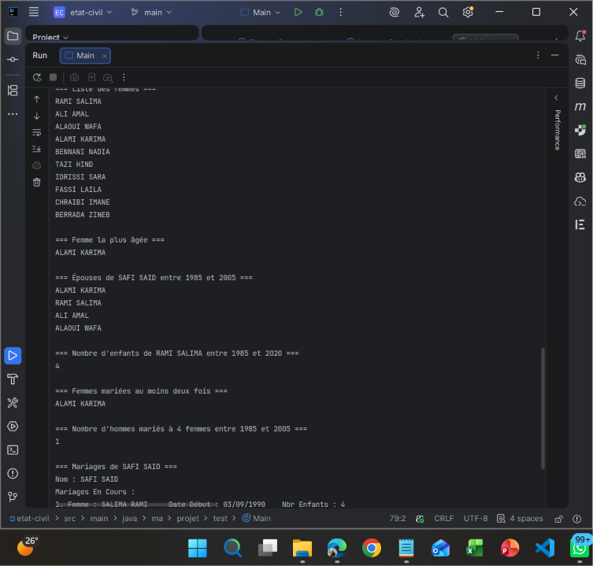
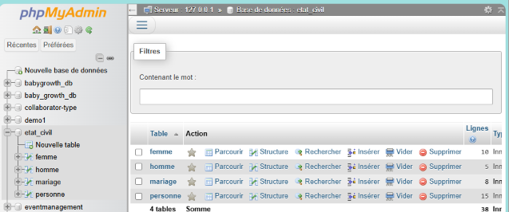

# TP — Hibernate / JPA avec MySQL

**Réalisé par :** Hibatalah Hamrani
**Filière :** Cycle ingénieur DSI — EMSI Marrakech
**Module :** Frameworks et architecture microservices

---

## 🎯 Objectif

Mettre en place la couche **persistance** et la couche **service** de trois applications Java avec **Hibernate 6 / JPA** et **MySQL** :

- mapper des entités avec les annotations JPA (`@Entity`, `@ManyToOne`, `@OneToMany`, `@Inheritance`…)
- représenter des **classes d'association** (relations plusieurs-à-plusieurs avec attributs)
- configurer Hibernate via `application.properties` et une classe `HibernateUtil`
- écrire une interface générique `IDao<T>` et des services CRUD
- interroger la base avec **HQL**, des **requêtes nommées**, une **requête native nommée** et l'**API Criteria**

---

## 🛠️ Technologies

- Java 17+
- Maven
- Hibernate ORM 6.4.4
- MySQL / MariaDB (XAMPP) — `mysql-connector-j` 8.3.0
- IntelliJ IDEA

---

## 📁 Structure du dépôt

```
tp-hibernate/
├── gestion-stock/      # Exercice 1 (+ screenshots/ex1-1.png, ex1-2.png)
├── gestion-projets/    # Exercice 2 (+ screenshots/ex2-1.png, ex2-2.png)
├── etat-civil/         # Exercice 3 (+ screenshots/ex3-1.png, ex3-2.png)
└── README.md
```

Chaque projet suit la même architecture en couches :

```
src/main/java/ma/projet/
├── classes/ (ou beans/)   # Entités JPA
├── util/HibernateUtil     # Création de la SessionFactory
├── dao/IDao               # Interface générique CRUD
├── service/               # AbstractService + services métier
└── test/Main              # Programme de test
src/main/resources/
└── application.properties # Configuration Hibernate / MySQL
```

### Couche commune

- **`IDao<T>`** : `create`, `delete`, `update`, `findById`, `findAll`
- **`AbstractService<T>`** : implémente `IDao<T>` une seule fois (ouverture de session, transaction, rollback). Chaque service en hérite et n'ajoute que ses méthodes spécifiques.
- **`HibernateUtil`** : charge `application.properties`, déclare les entités et construit la `SessionFactory`.
- **`hibernate.hbm2ddl.auto`** : les tables sont générées automatiquement à partir des entités.

---

## 📦 Exercice 1 — Gestion de stock

Application de gestion du stock d'un magasin de produits informatiques.

### Modèle



- `Produit` → `@ManyToOne` vers `Categorie`
- `LigneCommandeProduit` : classe d'association entre `Produit` et `Commande`, avec un id auto-incrémenté, deux `@ManyToOne` et une contrainte d'unicité (`produit_id`, `commande_id`)

### Fonctionnalités (`ProduitService`)

| Méthode | Technique |
|---|---|
| Produits par catégorie | HQL |
| Produits commandés entre deux dates | HQL (`between`) |
| Produits d'une commande donnée (affichage formaté) | HQL + `join fetch` |
| Produits dont le prix > 100 DH | **Requête nommée** `Produit.findByPrixSuperieur` |

### Résultats





---

## 📦 Exercice 2 — Gestion de projets

Suivi du temps passé sur les projets d'un bureau d'études.

### Modèle



### Fonctionnalités

| Service | Méthode | Technique |
|---|---|---|
| `EmployeService` | Tâches réalisées par un employé | HQL |
| `EmployeService` | Projets gérés par un employé | HQL |
| `ProjetService` | Tâches planifiées d'un projet | HQL |
| `ProjetService` | Tâches réalisées avec dates réelles (affichage formaté) | HQL + `join fetch` |
| `TacheService` | Tâches dont le prix > 1000 DH | **Requête nommée** `Tache.findByPrixSuperieur` |
| `TacheService` | Tâches réalisées entre deux dates | HQL |

### Résultats





---

## 📦 Exercice 3 — Gestion de l'état civil

Gestion des citoyens d'une province et de leurs relations matrimoniales.

### Modèle



- **Héritage** : `@Inheritance(strategy = InheritanceType.JOINED)` → une table `personne` pour les champs communs, et des tables `homme` et `femme` liées par l'identifiant
- **Mariage** : `dateFin = null` → mariage en cours ; `dateFin` renseignée → mariage échoué

### Fonctionnalités

| Service | Méthode | Technique |
|---|---|---|
| `HommeService` | Épouses d'un homme entre deux dates | HQL |
| `HommeService` | Nombre d'hommes mariés à 4 femmes entre deux dates | **API Criteria** (`groupBy` + `having`) |
| `HommeService` | Mariages d'un homme avec détails (en cours / échoués) | HQL + `join fetch` |
| `FemmeService` | Nombre d'enfants d'une femme entre deux dates | **Requête native nommée** `Femme.nbrEnfantsEntreDates` |
| `FemmeService` | Femmes mariées au moins deux fois | **Requête nommée** `Femme.marieesAuMoinsDeuxFois` |
| `FemmeService` | Femme la plus âgée | HQL (`order by` + `setMaxResults`) |

### Programme de test

Création de 10 femmes et 5 hommes, puis affichage de : la liste des femmes, la femme la plus âgée, les épouses d'un homme, le nombre d'enfants d'une femme, les femmes mariées au moins deux fois, le nombre d'hommes mariés à quatre femmes et les mariages détaillés d'un homme.

### Résultats





---

## 🚀 Exécution

1. Démarrer MySQL (XAMPP)
2. Ouvrir le projet souhaité dans IntelliJ (`gestion-stock`, `gestion-projets` ou `etat-civil`)
3. Adapter si besoin l'utilisateur et le mot de passe dans `src/main/resources/application.properties`
4. Lancer `ma.projet.test.Main`

Les bases `gestion_stock`, `gestion_projets` et `etat_civil` sont créées automatiquement (`createDatabaseIfNotExist=true`).

---

## 💡 Remarques techniques

- **Classes d'association** : elles sont modélisées avec un identifiant auto-incrémenté et deux `@ManyToOne`, plus une contrainte d'unicité. Une clé composée (`@EmbeddedId` + `@MapsId`) a d'abord été testée, mais avec Hibernate 6 elle provoquait une erreur `detached entity passed to persist`, car la clé est déjà renseignée avant l'insertion.
- **`application.properties`** : Hibernate lit par défaut `hibernate.properties`, donc `HibernateUtil` charge ce fichier manuellement avant de construire la `SessionFactory`.
- **Requête nommée vs native** : la requête nommée est écrite en HQL (classes et attributs Java), la requête native en SQL (tables et colonnes).
